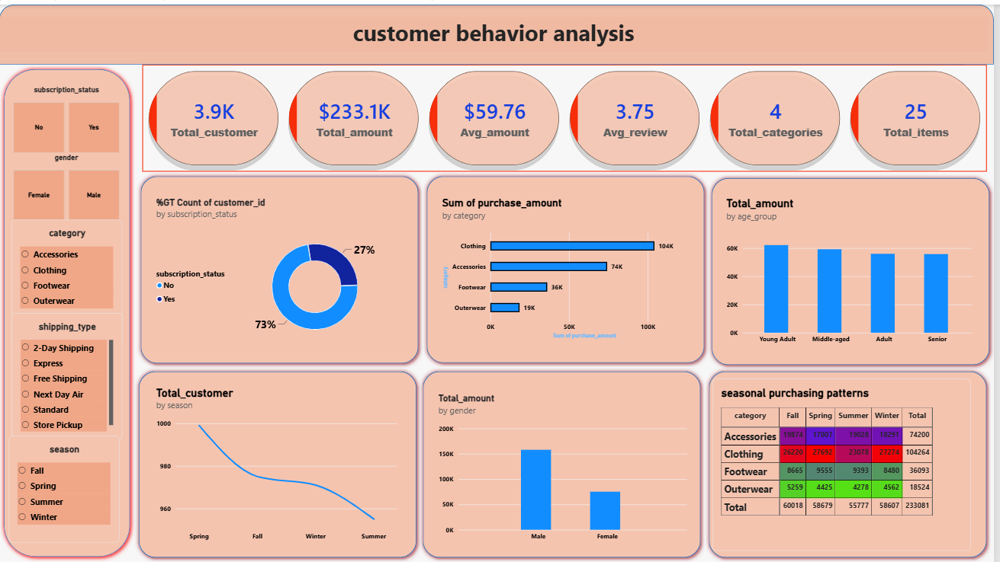

# 🛍️ Customer Shopping Behavior Analysis

An end-to-end data analytics project that explores how customers shop: what they buy, how much they spend, and what influences their decisions. The project covers data cleaning and EDA in **Python**, business analysis in **SQL**, and an interactive **Power BI** dashboard.

---

## 📌 Overview

Retail teams need to understand who their customers are and what drives spending. This project analyzes **3,900 customer transactions** to answer 32 business questions across sales, customer behavior, discounts, shipping and payment, satisfaction, and seasonality.

**Workflow:** Raw data → Cleaning & feature engineering (Python) → SQL analysis → Power BI dashboard → Insights

---

## 📂 Dataset

| Property | Detail |
|---|---|
| Records | 3,900 |
| Columns | 19 (after cleaning and feature engineering) |
| Source | Customer shopping behavior dataset (CSV) |

**Key columns:** `customer_id`, `age`, `gender`, `item_purchased`, `category`, `purchase_amount`, `location`, `size`, `color`, `season`, `review_rating`, `subscription_status`, `shipping_type`, `discount_applied`, `previous_purchases`, `payment_method`, `frequency_of_purchases`

**Engineered columns:** `age_group` (quartile-based), `purchase_frequency_days`

---

## 🛠️ Tools & Technologies

- **Python:** Pandas, NumPy, Matplotlib, Seaborn (Google Colab / Jupyter)
- **SQL:** MySQL-style queries for business analysis
- **Power BI:** Interactive dashboard
- **Git & GitHub:** Version control

---

## 🔄 Project Steps

1. **Data loading:** Imported the CSV into a Pandas DataFrame.
2. **Data cleaning:**
   - Filled missing `review_rating` values using the **median of each product category**
   - Checked for duplicates
   - Standardized column names (lowercase, underscores)
   - Dropped `promo_code_used` because it was identical to `discount_applied`
3. **Feature engineering:**
   - `age_group`: Young Adult, Adult, Middle-aged, Senior (quartile split)
   - `purchase_frequency_days`: converted purchase frequency labels (Weekly, Monthly, etc.) to days
4. **Exploratory data analysis:** Correlation heatmap, count plots, histograms, and box plots.
5. **SQL analysis:** 32 business questions grouped into six themes (see below).
6. **Dashboard:** Built an interactive Power BI report summarizing the key metrics.

---

## 🔍 SQL Analysis Themes

| Theme | Example questions |
|---|---|
| **A. Sales & Revenue** | Total revenue, average purchase, top categories, min/max amount |
| **B. Customer Behavior** | Spending by age group and gender, subscription share, purchase frequency |
| **C. Discounts & Promotions** | Discount usage by category, age group and subscription status |
| **D. Shipping & Payment** | Most popular shipping and payment methods, average spend by each |
| **E. Customer Satisfaction** | Average ratings, low-rated products, rating vs. purchase frequency |
| **F. Product & Seasonal Insights** | Popular items by season, top locations, color/size trends |

---

## 📊 Dashboard



The Power BI dashboard (`customer_behaviour_dashboard.pbix`) lets you filter and explore revenue, customer segments, discounts, shipping, payments, and ratings.

---

## 📈 Key Results

| Metric | Value |
|---|---|
| Total revenue | **$233,081** |
| Average purchase amount | **$59.76** |
| Unique customers | **3,900** |
| Average review rating | **3.75 / 5** |
| Subscribers | **27%** of customers |
| Purchases with a discount | **43%** |

**Insights**

- **Clothing** is the top revenue category ($104K), followed by Accessories ($74K).
- **Young Adults** spend the most overall, though spending is fairly even across age groups.
- **Male customers** account for roughly twice the total revenue of female customers (average purchase amount is nearly identical, about $60).
- **All subscribers used a discount**, versus about 22% of non-subscribers.
- Average spend is about the same with or without a discount (~$59 vs. ~$60), so discounts did not noticeably change basket size.
- Orders are spread evenly across seasons, shipping types, and payment methods, so no single option dominates.
- **Montana, Illinois, and California** are the top locations by revenue.

---

## 🗂️ Repository Structure

```
├── data/
│   └── customer.csv
├── notebooks/
│   └── customer_behaviour_analysis.ipynb
├── sql/
│   └── basic_query.sql
├── dashboard/
│   └── customer_behaviour_dashboard.pbix
├── images/
│   └── dashboard.png
└── README.md
```

---

## ▶️ How to Run

**1. Clone the repository**
```bash
git clone https://github.com/your-username/your-repo-name.git
cd your-repo-name
```

**2. Python analysis**
```bash
pip install pandas numpy matplotlib seaborn jupyter
jupyter notebook notebooks/customer_behaviour_analysis.ipynb
```
Update the CSV path in the notebook to point to `data/customer.csv`.

**3. SQL queries**
- Create a database and import `customer.csv` into a table named `customer`.
- Run the queries in `sql/basic_query.sql` in MySQL, PostgreSQL, or SQL Server (minor syntax changes may be needed).

**4. Power BI dashboard**
- Open `dashboard/customer_behaviour_dashboard.pbix` in Power BI Desktop.
- If prompted, refresh the data source and point it to `data/customer.csv`.

---

## 🚀 Future Improvements

- Customer segmentation with clustering (e.g., K-Means)
- Predict subscription or discount usage with a classification model
- Automate the cleaning pipeline with a Python script

---

## 👤 Author

**Aragala Govardhan Reddy**
 aragalavishnu30@gmail.com

⭐ If you found this project useful, consider giving it a star!
